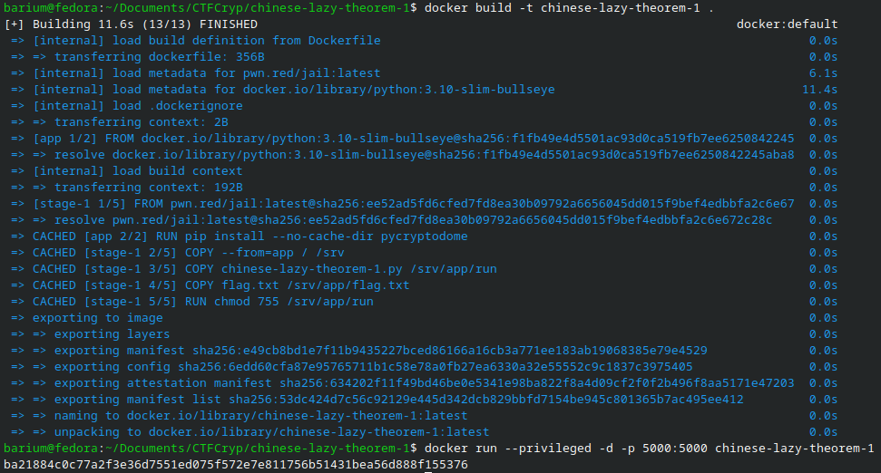
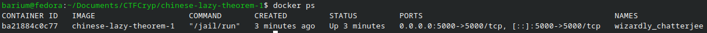
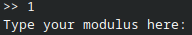
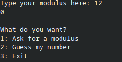
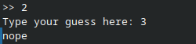
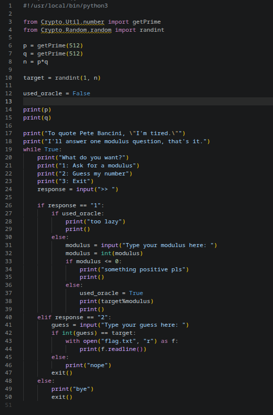
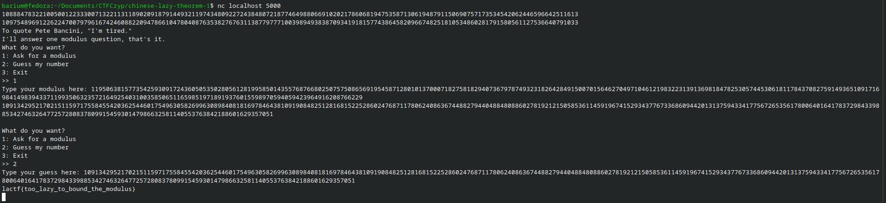
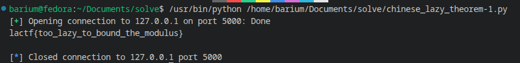

#Cryptography 
- Mô phỏng lại bài tập:
	- Do có file dockerfile nên ta có thể kích hoạt docker để mô phỏng lại môi trường bài tập
	- Mở terminal, nhập lệnh 
	  
		  docker build -t chinese-lazy-theorem-1 .
	  sau đó	  
	  
		  docker run --privileged -d -p 5000:5000 chinese-lazy-theorem-1
	- 
	- Kiểm tra môi trường đã được kích hoạt chưa bằng docker ps
	  
- Quy trình làm bài:
	- Đọc qua đề, ta có:
	  description: |-
		  I heard about this cool theorem called the Chinese Remainder Theorem, but, uh... I'm feeling kinda tired right now.
  
			  `{{nc}}`
		provide:
		  - ./chinese-lazy-theorem-1.py
	- {{nc}} : có vẻ đề bài muốn ta thực hiện netcat vào server. Do được mô phỏng lại, ta dùng lệnh 
			  nc localhost 5000
	  để kết nối vào server mô phỏng
	- Khi nhập lệnh ta thu được 
	  
	- Vào 1, ta nhận được:
	  
	- Nhập thử 12, ta nhận được:
	  
	- Nhập thử 2, hệ thống bảo ta nhập số mà ta đoán. Nhập thử 3 ta được:
	  
	- Dựa trên quy trình trên, ta có thể đặt ra vài giả thuyết sau:
		- Để tìm thấy cờ, ta cần phải đoán ra một số cụ thể, tạm gọi nó là target.
		- Khi nhập 1, bài cho ta nhập một số ngẫu nhiên m. Kết quả server trả về là  kết quả của phép target % m
		- Khi nhập 2, nếu ta nhập đúng target, ta sẽ nhận được cờ.
	- Ta kiểm tra file chinese-lazy-theorem-1.py được cung cấp trong provide:
	  
	- Dựa trên đoạn code trên, có thể khẳng định vài thứ:
		- Đầu tiên, giả thiết phía trên là đúng
		- Thứ hai, 2 số được đưa ra khi mới netcat là 2 số nguyên tố p và q
		- Thứ ba, target là số ngẫu nhiên sinh ra trong khoảng từ 1 đến pq
	- Dựa vào 3 điều trên, ta có giải pháp giải bài trên như sau: ta sẽ lấy tích của 2 số p và q, sau đó chọn 1 và nhập tích trên, chỉ có 2 khả năng có thể xảy ra: nếu ra 0, số cần tìm là tích p và q; nếu không ra 0 thì đó là số cần tìm.
	- Quay lại và thử, ta được:
		
	- Flag ta tìm thấy: lactf{too_lazy_to_bound_the_modulus}
	- Để tự động hóa quá trình giải bài trên, ta viết một đoạn code bằng thư viện pwntools:
``` python
from pwn import *

host = '127.0.0.1'
port = 5000

p = remote(host, port)

g = p.recvline().decode().strip()

p1 = int(g)

g = p.recvline().decode().strip()

q = int(g)

ans = p1 * q

p.recvuntil(b">> ")

p.sendline(b'1')
p.recvuntil(b"Type your modulus here: ")

p.sendline(str(ans).encode())

ans = p.recvline().decode().strip()

if ans == 0:
    ans = p1 * q

p.recvuntil(b">> ")
p.sendline(b'2')

p.sendline(str(ans).encode())
p.recvuntil(b"Type your guess here: ")
print(p.recvline().decode())

p.close()
```
Kết quả code chạy:

